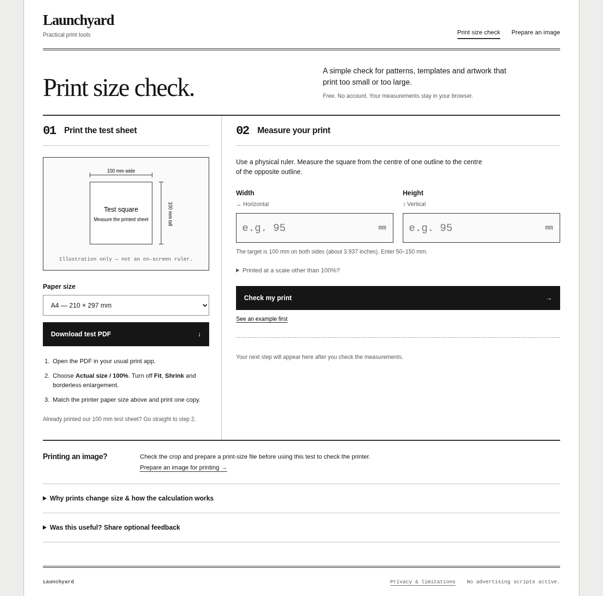

# Print scale calculator and true-size PDF proof

**[Open the free browser tool](https://launchyard-free-tools.pink-map-7606.chatgpt.site/print-scale/?utm_source=github)**

If a 100 mm reference prints too small, changing the image's DPI metadata is not enough to fix the print workflow. First match A4 or US Letter in both the document and printer settings, disable Fit/Shrink and borderless enlargement, print one proof, and measure horizontally and vertically.



## Print a proof before a full batch

1. Open the browser tool and select the paper actually loaded.
2. Download the one-page PDF and print using Actual size / 100%.
3. Use a physical ruler to measure both sides of its 100 × 100 mm square, centre of line to centre of line.
4. Enter those measurements and the scale setting used for that print.
5. If a uniform correction is suggested, apply it in the same print workflow and measure a second proof. For sewing patterns, check the pattern designer's own test square before cutting fabric.

Example: a 100 mm square printed as 95 × 95 mm at 100% gives a trial setting of 100 × 100 / 95 = 105.263%. If it prints as 95 × 100 mm, one percentage cannot correct both directions. Remeasure and inspect the paper/driver settings instead.

The 0.5 mm axis-difference threshold is a practical diagnostic assumption, not a manufacturer's tolerance. A PDF with correct coordinates does not certify a physical printer.

## Use the generator locally

`core.mjs` has no packages, networking or telemetry. It exports `diagnose({width, height, current})` and `proofPDF('a4' | 'letter')`. Measurements are in millimetres; current is a print percentage.

From the repository root, with Node.js 20 or later:

```sh
node --input-type=module -e 'import {writeFileSync} from "node:fs"; import {proofPDF} from "./tools/print-scale/core.mjs"; writeFileSync("proof-a4.pdf", proofPDF("a4"));'
```

Change both `a4` values to `letter` for US Letter. Open the PDF in your usual print app. Do not measure a screen preview as if it were a physical ruler.

## Verification and limits

The generator uses 72 PDF points per inch and 25.4 millimetres per inch. Arithmetic, PDF byte offsets/stream lengths, page sizes and the 100 mm square were checked; a separate PDF parser confirmed the geometry. No physical printer test has been performed. The hosted v8 interface was subsequently tested in a local browser at desktop/mobile sizes for A4/Letter downloads, input/result states, consent, feedback and route behavior. This does not verify production delivery or every printer driver. Source was developed with generative AI assistance.

The hosted page counts aggregate HTML requests, offers optional session-based action sharing, and accepts optional anonymous feedback. Measurements are not sent. These records are not unique people or proof of a successful print. The local generator sends nothing.

[Hosted privacy details](https://launchyard-free-tools.pink-map-7606.chatgpt.site/privacy/). No advertising scripts are currently active. No subscription or checkout is offered.

References: [Adobe on scaling printed pages](https://helpx.adobe.com/uk/acrobat/kb/scale-or-resize-printed-pages.html) and [Adobe Reader printing options](https://helpx.adobe.com/uk/reader/desktop/print-pdfs.html).

MIT licensed under this repository's LICENSE.

## Run the standalone browser version

The complete standalone UI is included as `index.html`, `app.mjs`, `core.mjs` and `style.css`. From the repository root, run:

```sh
python -m http.server 8080 --directory tools/print-scale
```

Open http://localhost:8080/ in a browser. This standalone version has no analytics or feedback endpoint. The separate hosted Site adds the optional research controls described above; its calculation/PDF core is the same. The UI and source were developed with AI assistance.
